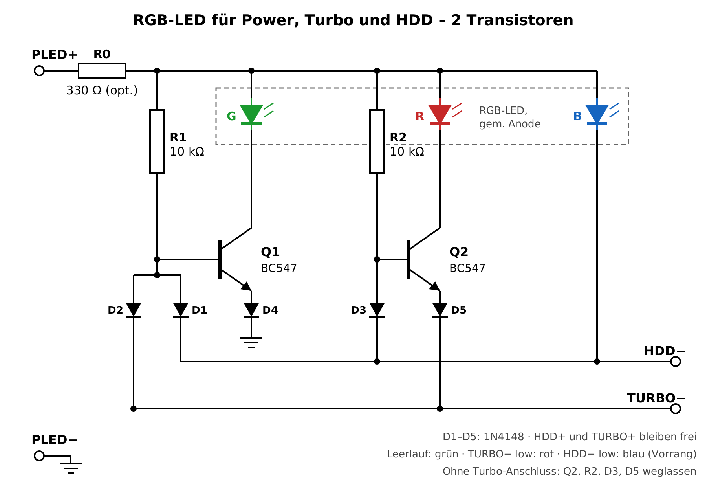

# XT-AT-PC-RGB-LED

**One RGB LED instead of separate power, turbo and HDD LEDs for retro PCs (XT / AT)**

| State | Colour |
|---|---|
| Power on | green |
| Turbo on | red (instead of green) |
| HDD activity | blue, overrides green and red |

It plugs into the normal mainboard headers (power LED, HDD LED, turbo LED). Two NPN transistors, five small diodes and two resistors, through-hole parts only, powered from the power LED header.

**Status: concept, simulated (ngspice).** Not built or tested yet.

## How it works

- Common anode of the RGB LED is fed from `PLED+`. The mainboard's own series resistor sets the current (optional R0 if the board has none).
- Blue cathode goes straight to `HDD-`. The open-collector HDD driver pulls it low on activity, exactly like the original HDD LED.
- Green: Q1 switches the green cathode to GND. R1 keeps Q1 on. D1 (from `HDD-`) or D2 (from `TURBO-`) pull its base down and turn green off. D4 in the emitter lifts the turn-on threshold above that one diode drop.
- Red: Q2 switches the red cathode to `TURBO-`, so red can only light while turbo is active. D3 pulls its base down on HDD activity, D5 again lifts the threshold.
- The diodes keep the two inputs apart: no input leaks into the other colour.
- `HDD+` and `TURBO+` are not used. Without a turbo connection leave out Q2, R2, D3 and D5.

Details, variants and simulation results: [docs/concept.md](docs/concept.md)

## Version 2

ATtiny84 board for an addressable LED and/or a plain RGB LED or RGB button, colours from a config file, no measuring of the headers needed: [v2/](v2/README.md)

## Parts

| Ref | Part | Note |
|---|---|---|
| R1, R2 | 10 kΩ, 1/4 W | base resistors |
| R0 | 330 Ω, 1/4 W | only if `PLED+` has no series resistor on the board, otherwise bridge |
| Q1, Q2 | BC547B (BC548, 2N3904 also fine) | |
| D1–D5 | 1N4148 | |
| LED1 | RGB LED 5 mm, common anode, diffused, 4 pins | 3 mm also fine |

## License

- Hardware: [CERN-OHL-S-2.0](LICENSE)
- Firmware and tools (v2): PolyForm Noncommercial 1.0.0, see [v2/LICENSE.md](v2/LICENSE.md)
- Documentation: CC BY-SA 4.0

## Authors

- **Stefan Fambach** (SteFam) – idea and concept, review and testing – https://www.fambach.net
- **Claude** (Anthropic AI) – implementation, via Claude Code

## AI disclosure

This project is built with AI assistance. Stefan Fambach had the idea, wrote the concept and reviews and tests every change; the implementation (schematics, simulation, firmware and documentation) is written largely by Claude (Anthropic) via Claude Code.
