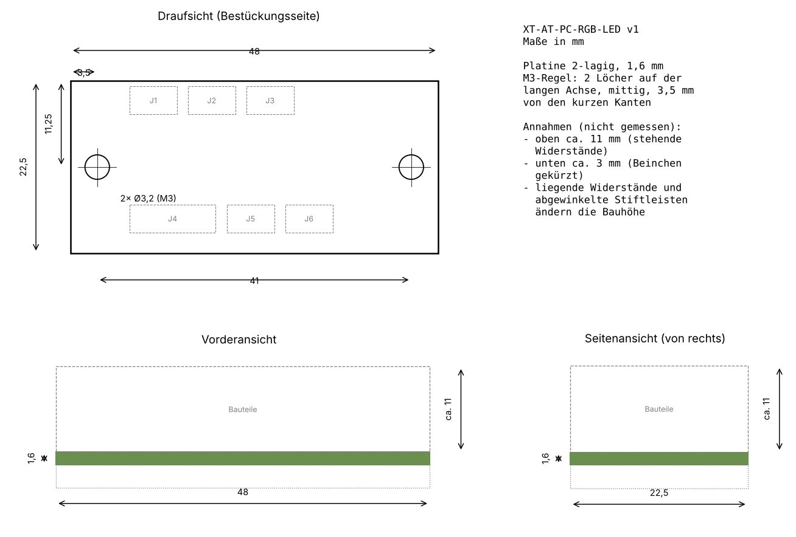
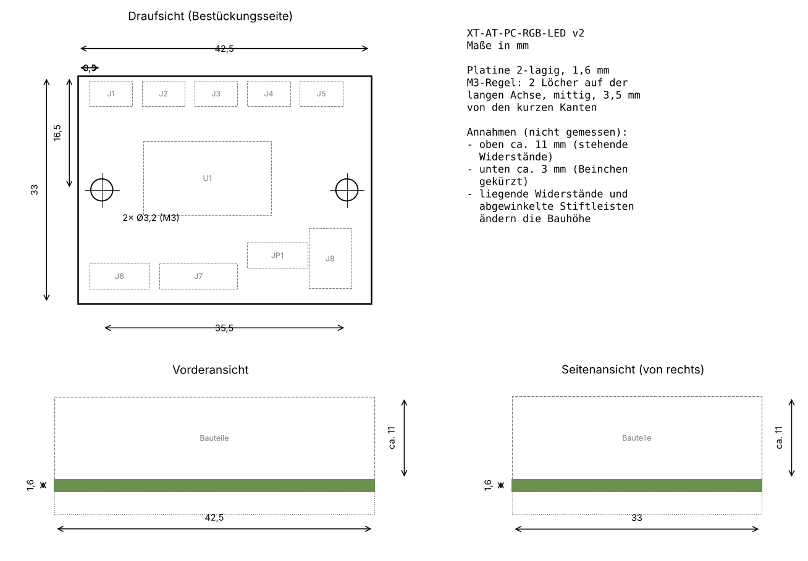

# Hardware

Two small through-hole boards, generated with KiCad 7 from Python scripts (`generator/`) and routed with Freerouting.

| Board | Size | Content |
|---|---|---|
| [v1](v1/) | 48 × 22.5 mm | discrete: 2× BC547, 5× 1N4148, 3 resistors |
| [v2](v2/) | 42.5 × 33 mm | ATtiny84 in a DIP-14 socket, 6-pin AVR ISP, addressable and plain RGB LED output |

Each folder has the KiCad project, schematic PDF, Gerber ZIP, DRC report and top/bottom renders. 2D dimension drawings (top, front and side view) are in [drawings/](drawings/), generated from the PCB by `generator/drawing.py`.

**Status: not manufactured, not tested.** DRC: 0 unconnected pads, only silkscreen overlaps left.

## Common rules

- **Mounting:** two M3 holes (3.2 mm) on the long axis, centred, 3.5 mm from the short edges – the same on every board.
- **Connectors:** 2.54 mm pin headers. Front panel headers are 1×2 with pin 1 = `+`, pin 2 = `-`, so the usual 2-pin case cables fit.
- **LED** on a cable (1×4 header), so the board can sit anywhere behind the front panel.
- **Button / switch:** `SW IN` and `SW OUT` are connected 1:1 (pass-through only, no electronics).

## Dimensions

| Board | Outline | Holes (from top left corner) |
|---|---|---|
| v1 | 48 × 22.5 × 1.6 mm | Ø3.2 at (3.5 / 11.25) and (44.5 / 11.25) |
| v2 | 42.5 × 33 × 1.6 mm | Ø3.2 at (3.5 / 16.5) and (39 / 16.5) |

Resistors and diodes stand upright (2.54 mm pitch). Assumed, not measured: about 11 mm component height above the board and about 3 mm leads below. Lying resistors or angled headers change the height.

On v2 the mounting holes sit between C1/C2 and next to R10/R11 instead of outside the parts, which keeps the board narrow.




## v1 connectors

| Ref | Pins | Function |
|---|---|---|
| J1 | PLED + / − | supply (power LED header) |
| J2 | HDD + / − | only `−` is used |
| J3 | TURBO + / − | only `−` is used |
| J4 | A R G B | RGB LED, common anode |
| J5 / J6 | SW IN / SW OUT | pass-through |

R0 only if `PLED+` has no series resistor on the mainboard, otherwise a wire bridge.

## v2 connectors

| Ref | Pins | Function |
|---|---|---|
| J1 | +5V GND | supply (speaker header / floppy connector, to be checked) |
| J2 / J3 | HDD, TURBO | any polarity, R1/R4 4.7 kΩ load between the pins |
| J4 / J5 | SW IN / SW OUT | pass-through |
| J6 | 5V DATA GND | addressable LED |
| J7 | COM R G B | plain RGB LED / RGB button, R9–R11 only when used |
| JP1 | A – COM – K | COM to +5 V (common anode) or GND (common cathode) |
| J8 | ISP | standard 6-pin AVR ISP (MISO VCC / SCK MOSI / RST GND) |

The ATtiny84 can also be programmed in a socket programmer (XGecu T48). MOSI is shared with the blue PWM output; the blue LED may flicker while programming.

## Rebuild

```
cd generator
FREEROUTING=/path/to/freerouting-1.9.0.jar sh build.sh v1
sh outputs.sh v1
```

Freerouting is not deterministic; if the DRC reports unconnected pads, run `build.sh` again.
